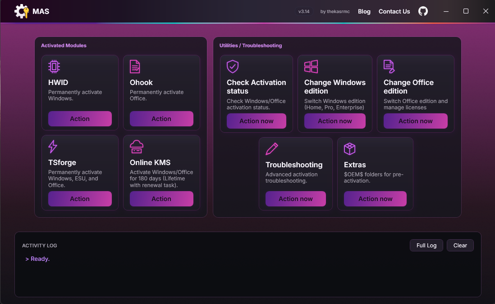

<p align="center">
  
</p>

<h1 align="center">Microsoft Activation Scripts GUI</h1>

<p align="center">
  A Windows desktop interface by <strong>Thekasrmc</strong> for working with selected
  <a href="https://github.com/massgravel/Microsoft-Activation-Scripts">Microsoft Activation Scripts (MAS)</a> workflows.
</p>

<p align="center">
  <a href="https://github.com/Thekasrmc/Microsoft-Activation-Scripts-GUI/releases/latest">Download the latest release</a>
  ·
  <a href="https://github.com/Thekasrmc/Microsoft-Activation-Scripts-GUI/issues">Report an issue</a>
</p>

<hr>

<p align="center">
  
</p>

## Download and run

1. Download **[MySystemGui.exe](https://github.com/Thekasrmc/Microsoft-Activation-Scripts-GUI/releases/download/v1.0.0/MySystemGui.exe)** from the [Releases page](https://github.com/Thekasrmc/Microsoft-Activation-Scripts-GUI/releases).
2. Open the executable. Windows will ask for administrator permission because some MAS workflows need elevated access.
3. Choose a module and follow the confirmation prompts. Check the Activity Log for status and details; use **Full Log** for the complete output.

The release is a self-contained, single-file Windows x64 application. You do not need to install the .NET runtime or download `MAS_AIO.cmd` separately. The app embeds the script and extracts it to the current user's Local Application Data folder when a workflow needs it.

## Included modules

- **HWID, Ohook, TSforge, and Online KMS** — open supported MAS activation workflows.
- **Activation status** — check Windows and Office licensing information.
- **Windows and Office edition tools** — open the corresponding native MAS menus when the workflow requires choices specific to the installed system.
- **Troubleshooting and Extras** — access supported repair tasks and utility options.

Some workflows open the original MAS console so that its own system checks, options, and confirmation steps are preserved. Choices shown in the GUI may need to be selected again in that console.

## Important

- This is an independent graphical frontend, not the official MAS project. The underlying script comes from the upstream MAS project linked above.
- Activation and repair workflows can change Windows or Office licensing and system state. Review the prompts and MAS output before continuing.
- **Fix Licensing** can clear licensing records and may require Windows or Office to be activated again.
- Use only software and product keys you are licensed to use. This app does not provide a license or product key.

## Build from source

Requirements: Windows and the **.NET 10 SDK**.

Run these commands from the repository root:

```powershell
dotnet restore .\MySystemGui.csproj
dotnet publish .\MySystemGui.csproj -c Release -r win-x64 --self-contained true -p:PublishSingleFile=true -p:DebugType=None -o .\publish\win-x64
```

The executable is written to `publish\win-x64\MySystemGui.exe`.

## Technology and license

The app is built with **WPF**, **.NET 10**, and [WPF-UI](https://github.com/lepoco/wpfui). See [LICENSE](LICENSE) for this repository's license. Refer to the upstream MAS project for its source, documentation, and licensing.
